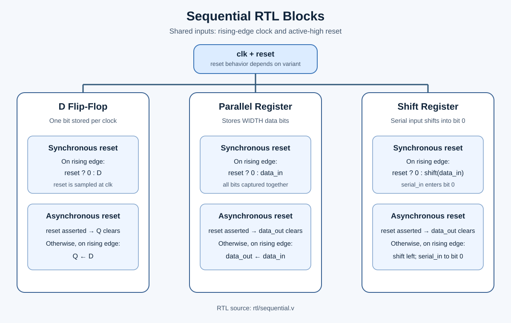
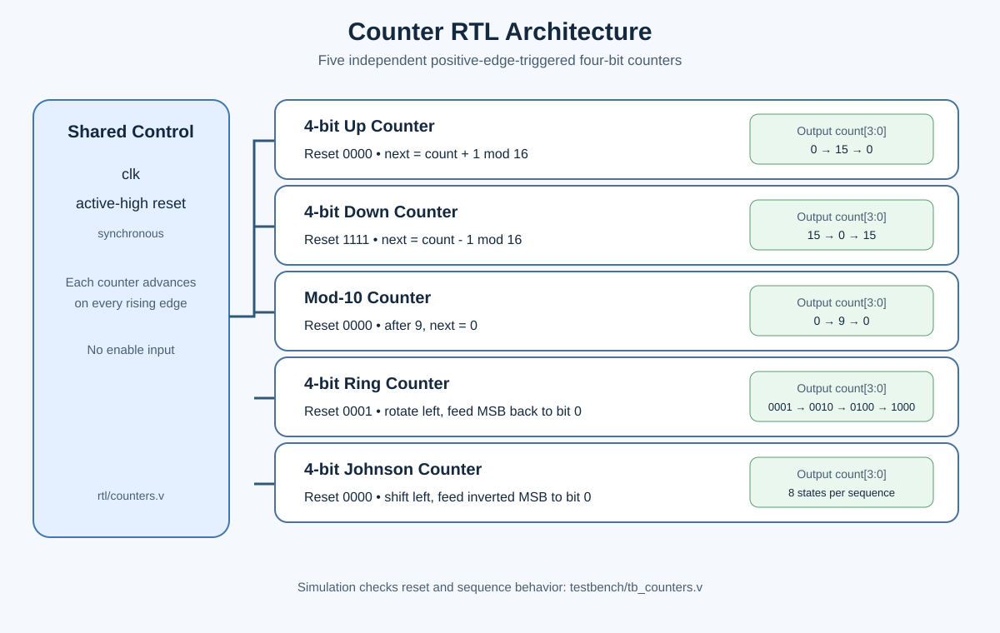
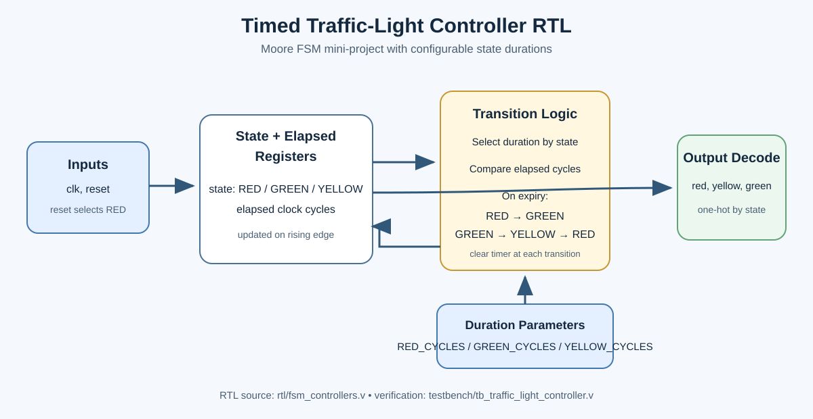

# Task 2 diagrams

These vector diagrams are embedded below for direct preview on GitHub.

## RTL design and verification overview

## Sequential RTL blocks

## Counter architecture

## Timed traffic-light RTL block

## Moore traffic-light FSM

## Vending machine FSM

## Elevator controller FSM

## Clock and reset timing

The timing figure is conceptual. Captured GTKWave screenshots are embedded in [waveforms/README.md](../../waveforms/README.md), with the corresponding VCD traces under `simulation/vcd/`.
