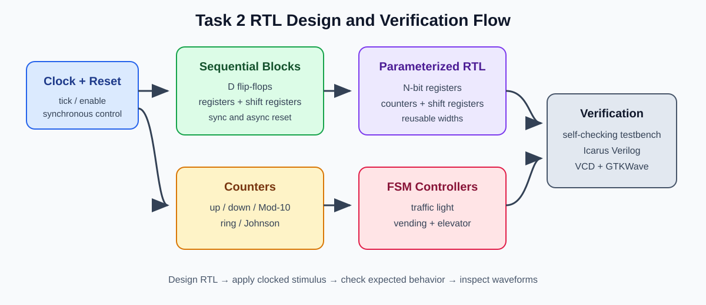
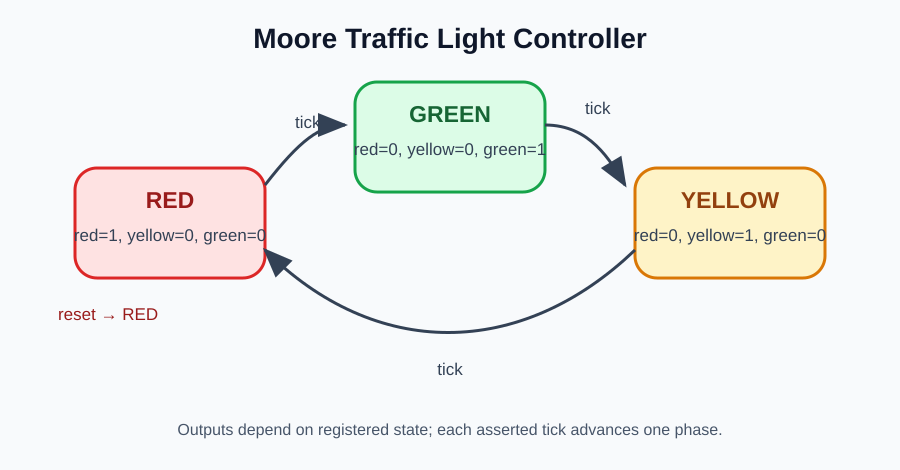
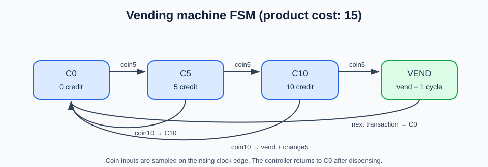
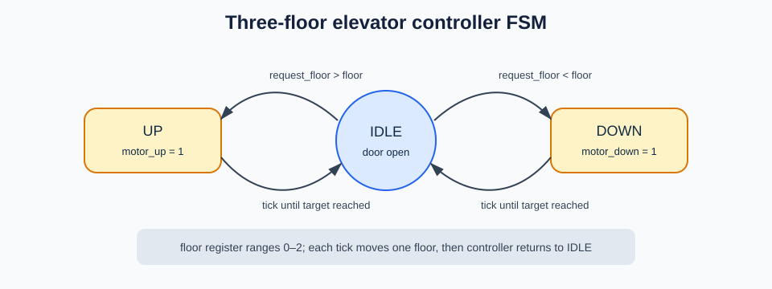
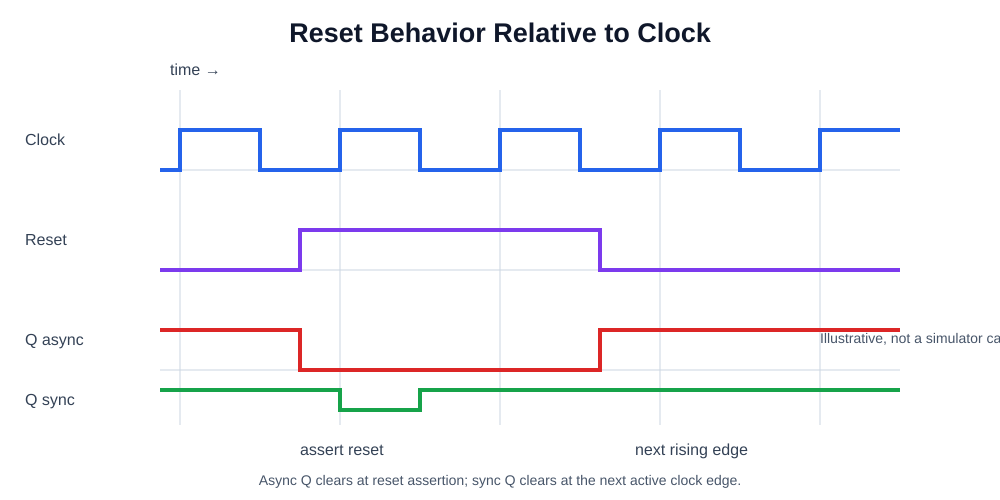

# Task 2 diagrams

The vector diagrams are embedded here for direct preview on GitHub.

## RTL design overview

## Moore traffic-light FSM

## Vending machine FSM

## Elevator controller FSM

## Clock and reset timing

The timing figure is conceptual. Captured simulation waveforms are in `simulation/vcd/`; GTKWave screenshots are still pending.
