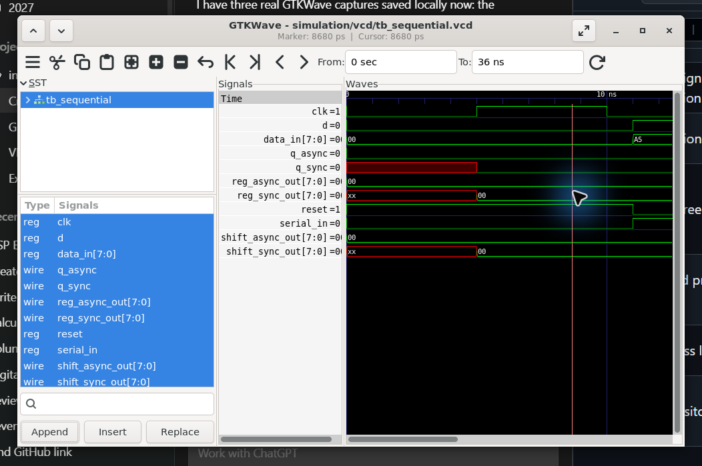
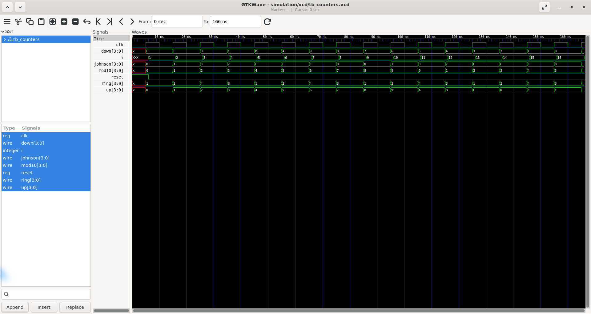
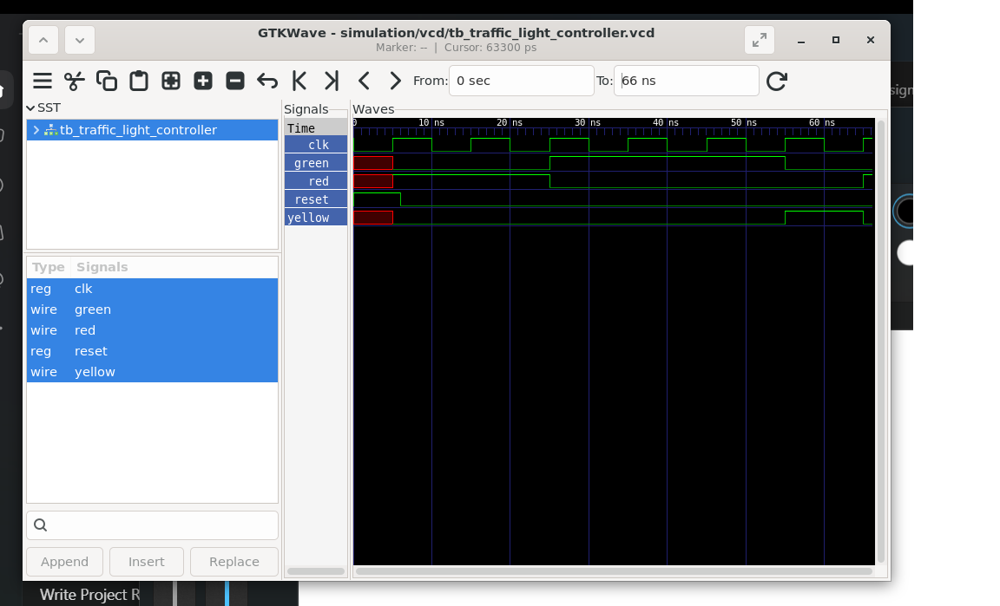
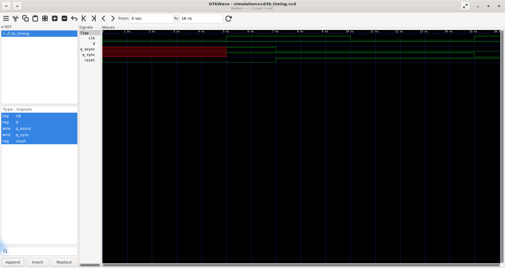

# GTKWave screenshots

The Task 2 PDF requests GTKWave screenshots but does not specify a required count. These four captures show representative outputs for key parts of the project. All seven testbenches also have committed simulator logs and VCD traces.

## Sequential logic

## Counters

## Timed traffic-light controller

## Reset timing

